<div align="center">

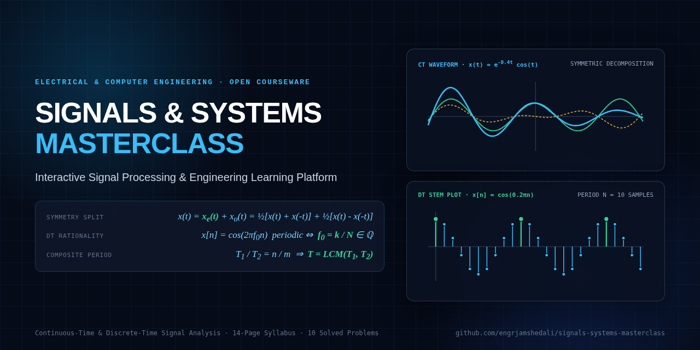

# Signals & Systems Masterclass

**An Interactive Signal Processing & Engineering Learning Platform**

[](https://react.dev/)
[](https://www.typescriptlang.org/)
[](https://vite.dev/)
[](https://tailwindcss.com/)
[](https://www.apache.org/licenses/LICENSE-2.0)
[](#core-modules--mathematical-foundations)

*Master Continuous-Time and Discrete-Time signal classification, even and odd symmetry decomposition, periodicity proofs, and fundamental period calculations through interactive visualizations and step-by-step worked solutions.*

[Overview](#overview) · [Key Features](#key-features) · [Screenshot Gallery](#screenshot-gallery) · [Mathematical Foundations](#mathematical-foundations) · [Installation](#installation--local-setup) · [Architecture](#project-architecture) · [Author](#author)

</div>

---

## Overview

**Signals & Systems Masterclass** is an interactive web-based engineering education platform designed to translate foundational Signals and Systems coursework into intuitive visual and mathematical explorations. Built around a complete 14-page curriculum covering continuous-time (CT) and discrete-time (DT) signal analysis, the application pairs real-time SVG waveform oscilloscopes and stem plots with progressive algebraic proofs, worked problem solutions, and exam-focused conceptual quizzes.

Whether you are reviewing symmetry properties for Fourier analysis, verifying why discrete-time sinusoids without $\pi$ fail periodicity, or solving composite Least Common Multiple (LCM) periods, every module provides live mathematical feedback alongside clear pedagogical explanations.

---

## Key Features

- **4-Axis Signal Classification Dashboard**: Structured taxonomy covering *Even vs. Odd*, *Periodic vs. Non-Periodic*, *Deterministic vs. Random*, and *Energy vs. Power* signals with direct links to interactive labs.
- **Interactive Even & Odd Signal Laboratory**:
  - Real-time SVG oscilloscope supporting 6 lecture presets (`5 sin(t)`, `4 cos(t)`, `e^(-0.4t) cos(t)`, `sin(t) + cos(t) + sin(t)cos(t)`, 2nd-degree polynomials, and an asymmetric piecewise triangle pulse).
  - Independent layer toggles for original signal $x(t)$, time-reversed signal $x(-t)$, even component $x_e(t)$, odd component $x_o(t)$, and reconstructed sum $x_e(t) + x_o(t)$.
  - Draggable inspection cursor $t_0 \in [0.1, 5.0]\text{ s}$ with live numerical verification confirming $x_e(t_0) + x_o(t_0) = x(t_0)$.
  - Progressive 4-step algebraic blackboard derivation and engineering significance notes (Fourier Series speedup and linear-phase FIR filter design).
- **Periodicity Laboratory & The Discrete-Time $\pi$-Trap**:
  - Side-by-side interactive discrete stem plots (15 to 60 samples) contrasting periodic $x_1[n] = \cos(0.2\pi n)$ ($N = 10$ samples) with aperiodic $x_2[n] = \cos(0.2n)$.
  - Interactive **Composite Signal & LCM Periodicity Solver** testing the rationality condition $T_1 / T_2 \in \mathbb{Q}$ and computing $T = \operatorname{LCM}(T_1, T_2)$.
  - Dedicated **Power Reduction Explorer** demonstrating why $\cos^2(2\pi t)$ doubles oscillation frequency and halves fundamental period.
- **Step-by-Step Problem-Solving Workshop**:
  - Complete progressive solutions for all **10 worked examples and homework problems** across continuous-time and discrete-time domains.
  - Step-by-step reveal controls, final answer verification banners, key conceptual insights, common exam pitfall warnings, and direct links to simulate each signal type in the labs.
- **Page-by-Page Lecture Notes Companion (Pages 1–14)**:
  - Synchronized index spanning all 14 lecture pages with summaries, transcribed equations, chalkboard insights, and page-specific exam traps.
- **Interactive Self-Assessment Quiz Arena**:
  - 6 exam-style conceptual and numerical questions featuring on-demand hints, instant answer validation, step-by-step breakdowns, and final mastery scoring.

---

## Screenshot Gallery

<table>
  <tr>
    <td width="50%" valign="top">
      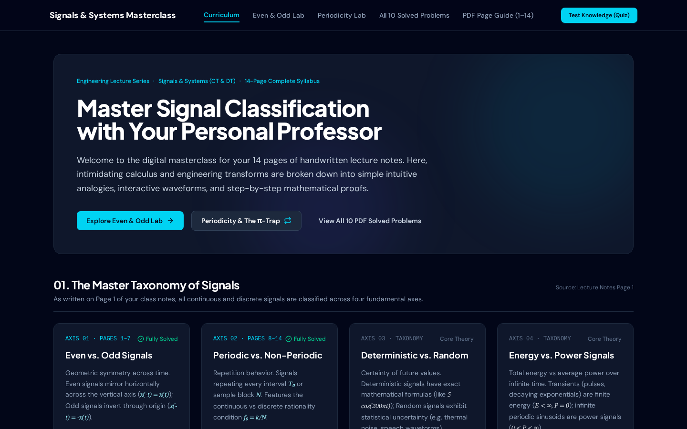
      <p align="center"><b>1. Interactive Learning Dashboard</b><br/><sub>Hero overview with direct navigation to labs and worked problems</sub></p>
    </td>
    <td width="50%" valign="top">
      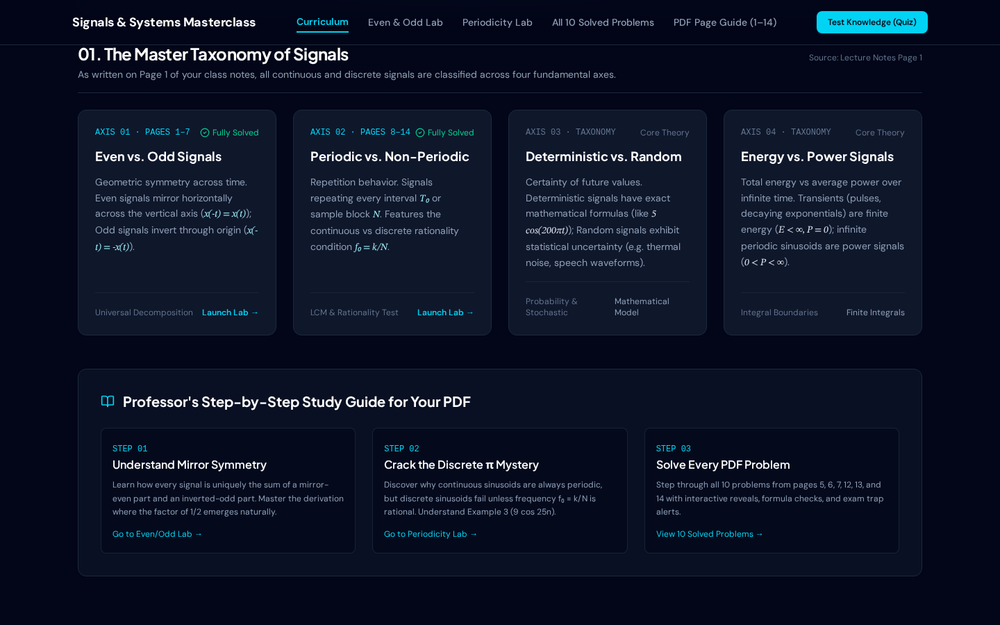
      <p align="center"><b>2. Master Signal Taxonomy</b><br/><sub>Four core signal classifications and 3-step study roadmap</sub></p>
    </td>
  </tr>
  <tr>
    <td width="50%" valign="top">
      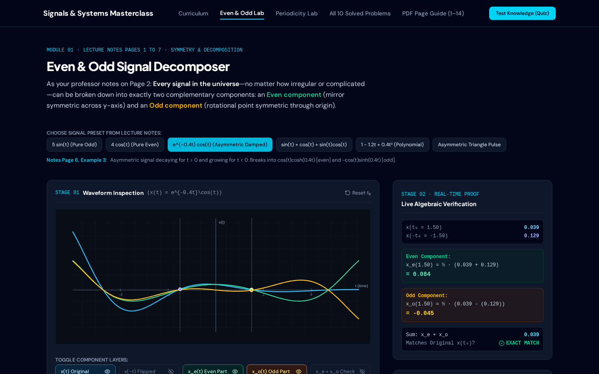
      <p align="center"><b>3. Even &amp; Odd Signal Laboratory</b><br/><sub>Preset signal selector, live waveform plot, and numerical proof</sub></p>
    </td>
    <td width="50%" valign="top">
      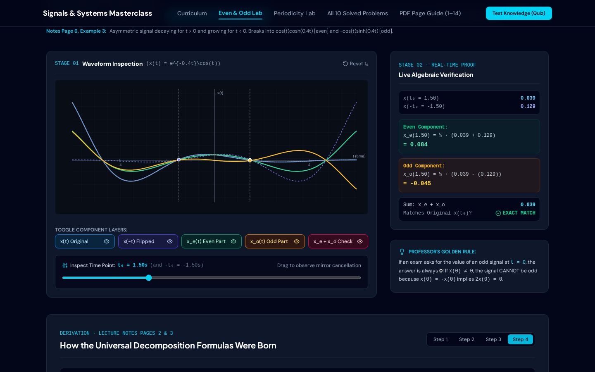
      <p align="center"><b>4. Interactive Oscilloscope &amp; Reconstruction</b><br/><sub>Independent layer visibility toggles and draggable cursor <code>t₀</code></sub></p>
    </td>
  </tr>
  <tr>
    <td width="50%" valign="top">
      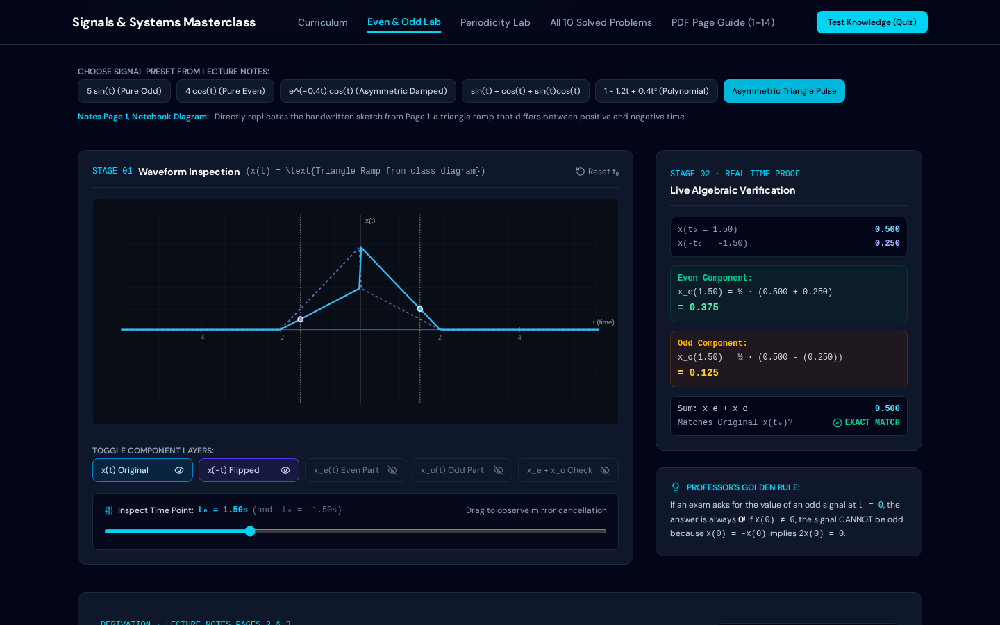
      <p align="center"><b>5. Time-Reversal Inspection</b><br/><sub>Comparing asymmetric pulse <code>x(t)</code> against reflected <code>x(-t)</code></sub></p>
    </td>
    <td width="50%" valign="top">
      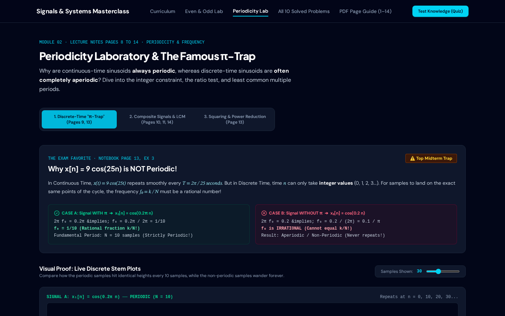
      <p align="center"><b>6. Periodicity Laboratory</b><br/><sub>Continuous vs. discrete periodicity criteria and rationality checks</sub></p>
    </td>
  </tr>
  <tr>
    <td width="50%" valign="top">
      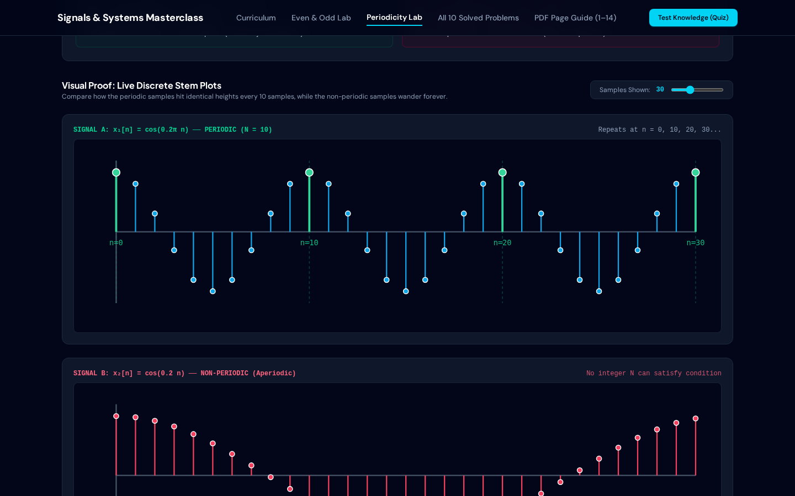
      <p align="center"><b>7. Discrete-Time &pi;-Trap Experiment</b><br/><sub>Live stem plots comparing periodic <code>cos(0.2&pi;n)</code> and aperiodic <code>cos(0.2n)</code></sub></p>
    </td>
    <td width="50%" valign="top">
      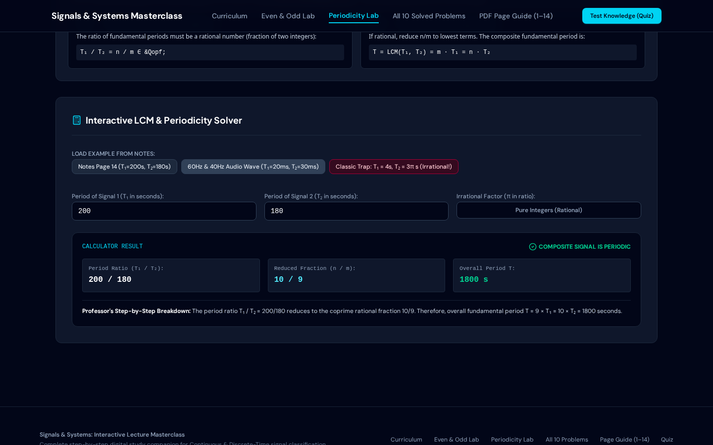
      <p align="center"><b>8. Fundamental Period &amp; LCM Solver</b><br/><sub>Automated period ratio rationality test and LCM period calculation</sub></p>
    </td>
  </tr>
  <tr>
    <td width="50%" valign="top">
      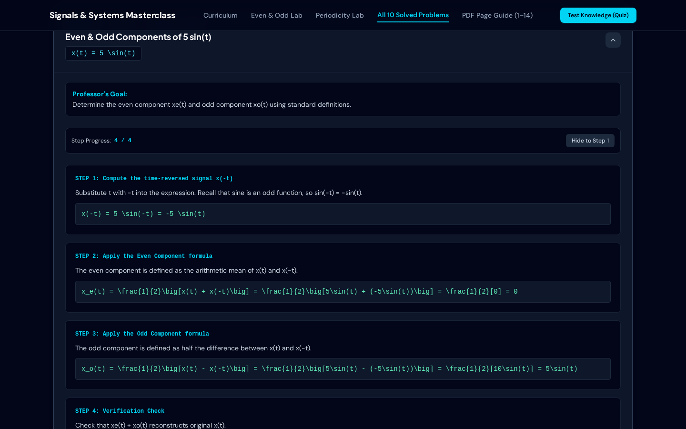
      <p align="center"><b>9. Step-by-Step Problem-Solving Workshop</b><br/><sub>All 10 solved problems with progressive step reveals and exam traps</sub></p>
    </td>
    <td width="50%" valign="top">
      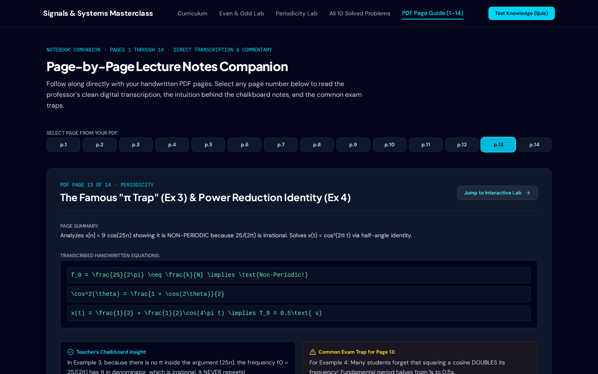
      <p align="center"><b>10. PDF Lecture Notes Companion</b><br/><sub>Structured 14-page curriculum guide with transcribed equations</sub></p>
    </td>
  </tr>
  <tr>
    <td width="50%" valign="top">
      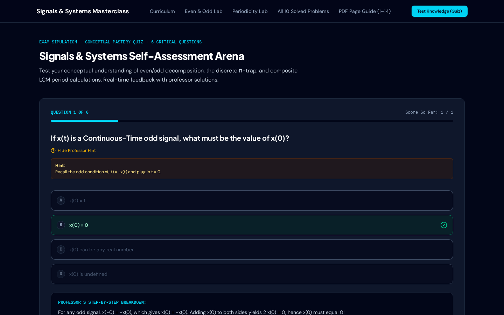
      <p align="center"><b>11. Interactive Quiz Arena</b><br/><sub>On-demand professor hints, instant grading, and conceptual proofs</sub></p>
    </td>
    <td width="50%" valign="top">
      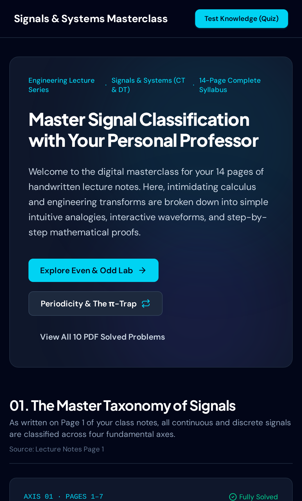
      <p align="center"><b>12. Responsive Mobile Interface</b><br/><sub>Clean single-column adaptive layout for handheld study</sub></p>
    </td>
  </tr>
</table>

---

## Mathematical Foundations

### 1. Even & Odd Signal Symmetry & Decomposition

A continuous-time signal $x(t)$ is **even** if $x(-t) = x(t)$ for all $t$, and **odd** if $x(-t) = -x(t)$ for all $t$ (which implies $x(0) = 0$). Any arbitrary signal can be uniquely decomposed into its even and odd components:

$$x(t) = x_e(t) + x_o(t)$$

$$x_e(t) = \frac{1}{2}\big[x(t) + x(-t)\big], \qquad x_o(t) = \frac{1}{2}\big[x(t) - x(-t)\big]$$

For discrete-time sequences $x[n]$, the identical decomposition applies across integer sample indices $n \in \mathbb{Z}$:

$$x_e[n] = \frac{1}{2}\big[x[n] + x[-n]\big], \qquad x_o[n] = \frac{1}{2}\big[x[n] - x[-n]\big]$$

### 2. Continuous-Time & Discrete-Time Periodicity

A continuous-time signal is periodic if there exists a smallest positive real period $T_0 > 0$ such that $x(t) = x(t + T_0)$, with fundamental frequency $f_0 = \frac{1}{T_0}$ and angular frequency $\omega_0 = 2\pi f_0$.

In contrast, a discrete-time sinusoid $x[n] = \cos(2\pi f_0 n)$ is periodic **if and only if** its normalized digital frequency $f_0$ is a rational number:

$$f_0 = \frac{k}{N} \in \mathbb{Q} \quad (k, N \in \mathbb{Z},\; N > 0)$$

When $\omega_0$ lacks a factor of $\pi$ (such as $x[n] = 9\cos(25n)$), $f_0 = \frac{25}{2\pi} \notin \mathbb{Q}$, making the discrete-time signal strictly **non-periodic (aperiodic)**.

### 3. Composite Signal Periodicity & LCM Rule

For a sum of two periodic signals $x(t) = x_1(t) + x_2(t)$ with individual fundamental periods $T_1$ and $T_2$, the composite signal is periodic if and only if their period ratio is rational:

$$\frac{T_1}{T_2} = \frac{n}{m} \in \mathbb{Q} \implies T = \operatorname{LCM}(T_1, T_2) = m T_1 = n T_2$$

### 4. Curriculum Problem Set Covered

| # | Expression | Domain | Topic | Final Result |
|:-:|:---|:---:|:---|:---|
| 1 | $x(t) = 5\sin(t)$ | CT | Even / Odd | $x_e(t) = 0,\; x_o(t) = 5\sin(t)$ |
| 2 | $x(t) = \sin(t) + \cos(t) + \sin(t)\cos(t)$ | CT | Even / Odd | $x_e(t) = \cos(t),\; x_o(t) = \sin(t) + \sin(t)\cos(t)$ |
| 3 | $x(t) = e^{-2t}\cos(t)$ | CT | Even / Odd | $x_e(t) = \cos(t)\cosh(2t),\; x_o(t) = -\cos(t)\sinh(2t)$ |
| 4 | $x(t) = 1 + t + 3t^2 + 5t^3 + 9t^4$ | CT | Even / Odd | $x_e(t) = 1 + 3t^2 + 9t^4,\; x_o(t) = t + 5t^3$ |
| 5 | $x(t) = 1 + t\cos(t) + t^2\sin(t) + t^3\sin(t)\cos(t)$ | CT | Even / Odd | $x_e(t) = 1 + t^3\sin(t)\cos(t),\; x_o(t) = t\cos(t) + t^2\sin(t)$ |
| 6 | $x(t) = 5\cos(200\pi t)$ | CT | Periodicity | $f_0 = 100\text{ Hz},\; T_0 = 10\text{ ms}$ |
| 7 | $x[n] = 12\sin(25\pi n)$ | DT | Periodicity | Periodic with $N = 2\text{ samples}$ |
| 8 | $x[n] = 9\cos(25n)$ | DT | $\pi$-Trap | Non-Periodic ($f_0 = \frac{25}{2\pi} \notin \mathbb{Q}$) |
| 9 | $x(t) = \cos^2(2\pi t)$ | CT | Power Reduction | $f_0 = 2\text{ Hz},\; T_0 = 0.5\text{ s}$ |
| 10 | $x(t) = 4\cos(\frac{\pi}{100}t) + 2\cos(\frac{2\pi}{180}t)$ | CT | Composite LCM | Periodic with $T = 1800\text{ s}$ |

---

## Technology Stack

| Layer | Technology | Purpose |
|:---|:---|:---|
| **UI Framework** | React `19.0` & React DOM `19.0` | Component-driven interactive state management |
| **Language** | TypeScript `7.0` | Strict static typing across signal presets, steps, and quizzes |
| **Build Tool** | Vite `8.3` & `@vitejs/plugin-react` | Fast development server and optimized production bundling |
| **Styling** | Tailwind CSS `4.3` (`@tailwindcss/vite`) | Responsive layout, dark engineering slate theme, and typography |
| **Icons** | Lucide React `0.546` | Crisp vector UI affordances and status indicators |
| **Visualization** | Custom Responsive SVG Engines | Real-time continuous waveform plotting and discrete stem rendering |

---

## Installation & Local Setup

### Prerequisites

- **Node.js** (v18+ recommended)
- **npm**

### Clone & Run Locally

```bash
git clone https://github.com/engrjamshedali/signals-systems-masterclass.git

cd signals-systems-masterclass

npm install

npm run dev
```

The development server starts on `http://localhost:3000` (`vite --port=3000 --host=0.0.0.0`).

### Validation & Production Scripts

| Command | Script | Description |
|:---|:---|:---|
| `npm run dev` | `vite --port=3000 --host=0.0.0.0` | Starts the local development server on port `3000` |
| `npm run lint` | `tsc --noEmit` | Runs TypeScript static type validation across all source files |
| `npm run build` | `vite build` | Compiles and bundles production assets into `dist/` |
| `npm run preview` | `vite preview` | Serves the production build locally for verification |
| `npm run clean` | `rm -rf dist server.js` | Cleans build artifacts |

---

## Usage Guide

1. **Curriculum**: Start on the homepage to review the 4-axis signal taxonomy and follow the 3-step roadmap.
2. **Even & Odd Lab**: Select any of the 6 presets, toggle visibility for $x(t)$, $x(-t)$, $x_e(t)$, $x_o(t)$, or $x_e(t)+x_o(t)$, drag the $t_0$ inspection slider, and step through the 4-stage blackboard proof.
3. **Periodicity Lab**: Switch across the *Discrete-Time $\pi$-Trap*, *Composite Signals & LCM Solver*, and *Power Reduction* tabs to experiment with sample counts, custom periods $T_1, T_2$, and irrationality flags.
4. **All 10 Solved Problems**: Filter by *Even/Odd Symmetry* or *Periodicity & LCM*, reveal proofs one step at a time, check common exam traps, and jump directly to the corresponding interactive lab.
5. **PDF Page Guide (1–14)**: Browse pages `p.1` through `p.14` to review equations, summaries, and chalkboard insights mapped to the original lecture notes.
6. **Test Knowledge (Quiz)**: Answer the 6 self-assessment questions using optional hints and review full step-by-step explanations upon submission.

---

## Project Architecture

```text
signals-systems-masterclass/
├── assets/
│   └── readme/
│       ├── banner.png                      # Repository hero banner
│       └── screenshots/                    # Verified UI & visualization screenshots
├── src/
│   ├── components/
│   │   ├── EvenOddVisualizer.tsx           # Oscilloscope, layer toggles, t0 cursor & 4-step proof
│   │   ├── Footer.tsx                      # Quick-access navigation footer
│   │   ├── HeroSection.tsx                 # Landing hero, 4-axis taxonomy & study roadmap
│   │   ├── InteractiveQuiz.tsx             # 6-question exam quiz with hints & scoring
│   │   ├── Navbar.tsx                      # Sticky 3-zone top navigation bar
│   │   ├── PdfPagesCompanion.tsx           # Page-by-page (1–14) lecture notes viewer
│   │   ├── PeriodicityLab.tsx              # DT stem plots, LCM solver & power reduction tab
│   │   └── WorkedProblemsWorkshop.tsx      # Interactive step-reveal solver for all 10 problems
│   ├── data/
│   │   └── lectureNotesData.ts             # Structured 14 pages, 10 problems & quiz bank
│   ├── App.tsx                             # Root tab state & layout shell
│   ├── index.css                           # Tailwind CSS import & custom typography classes
│   └── main.tsx                            # React DOM entry point
├── index.html                              # Document metadata & Google Fonts configuration
├── metadata.json                           # Application manifest metadata
├── package.json                            # Dependencies and npm scripts
├── tsconfig.json                           # TypeScript compiler configuration
└── vite.config.ts                          # Vite & Tailwind CSS plugin configuration
```

---

## Suggested GitHub Repository Metadata

- **Repository Description**: `Interactive Signals & Systems learning platform featuring real-time CT/DT waveform visualizers, even/odd decomposition, π-trap stem plots, LCM period solver, and 10 step-by-step worked problems.`
- **Recommended GitHub Topics**: `signals-and-systems` · `signal-processing` · `engineering-education` · `signal-visualization` · `discrete-time-signals` · `continuous-time-signals` · `electrical-engineering` · `react` · `typescript` · `vite`

---

## Contributing

Contributions that enhance educational clarity, add new signal presets, or expand worked problem coverage are welcome:

1. Fork the repository.
2. Create a feature branch (`git checkout -b feature/new-signal-module`).
3. Commit your changes with clear, descriptive messages.
4. Run `npm run lint` and `npm run build` to verify zero TypeScript or build errors.
5. Open a Pull Request detailing your enhancement.

---

## License

This project is licensed under the **Apache License 2.0** (`SPDX-License-Identifier: Apache-2.0`).

---

## Author

**Jamshed Ali**  
Computer Systems Engineering Student | Developer | Technology Enthusiast  
GitHub: [https://github.com/engrjamshedali](https://github.com/engrjamshedali)

*Built as an educational engineering project to make Signals & Systems intuitive, visual, and accessible.*
